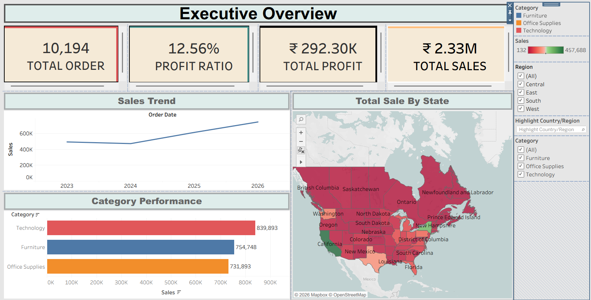

# E-Commerce Sales & Customer Analytics Dashboard (Tableau)

## Project Overview
This project is an interactive Tableau dashboard designed to analyze e-commerce sales performance, profitability, and customer behavior. Using the Sample Superstore dataset, it helps stakeholders track KPIs, identify top-performing products, and spot regional trends.

## Dashboard Preview

## Dataset
* **Source:** Sample Superstore (Sample - Superstore.xlsx)
* **Contents:** Order details, customer segments, product categories, regional sales, profit, and shipping data.

## Key Features & Visuals
* **KPI Summary:** Total Sales, Total Profit, Profit Margin, and Total Orders.
* **Sales & Profit Trends:** Monthly/yearly performance tracking.
* **Category & Sub-Category Breakdown:** Identifying high-revenue vs. high-profit products.
* **Customer & Regional Analysis:** Top customers, segment distribution, and geographic sales map.
* **Interactive Filters:** Filter dynamically by Date, Region, Category, and Segment.

## Key Insights
* [Insight 1: e.g., Technology generated the highest revenue, while Furniture had the lowest profit margin.]
* [Insight 2: e.g., Sales peak consistently in Q4 (November–December).]
* [Insight 3: e.g., The West region leads in both total sales and overall profitability.]

## Tools Used
* **Tableau Desktop / Tableau Public** (Data Visualization & Dashboarding)
* **Microsoft Excel** (Dataset storage)

## How to View This Project
1. **Live Interactive Version:** https://drive.google.com/file/d/1AgfE5RUwg50VAhbrNnH_Kmwg_TREQCAW/view?usp=drive_link
2. **Download Locally:** Click on the `.twbx` / `.twb` file in this repository, click **Download**, and open it in Tableau Desktop or Tableau Public.
